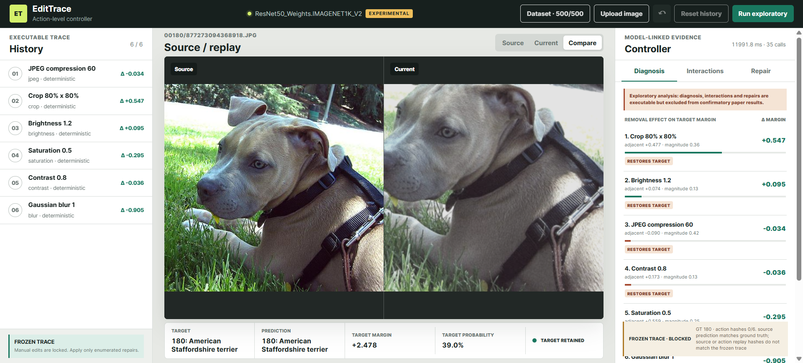
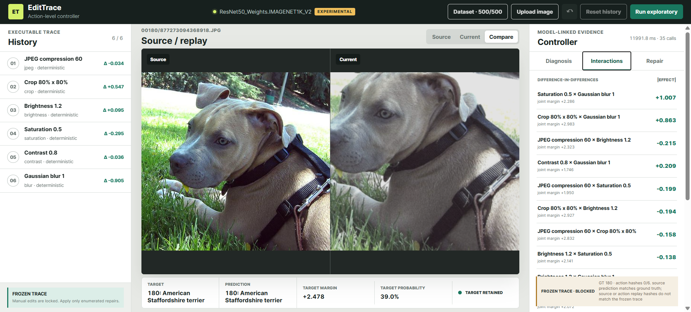
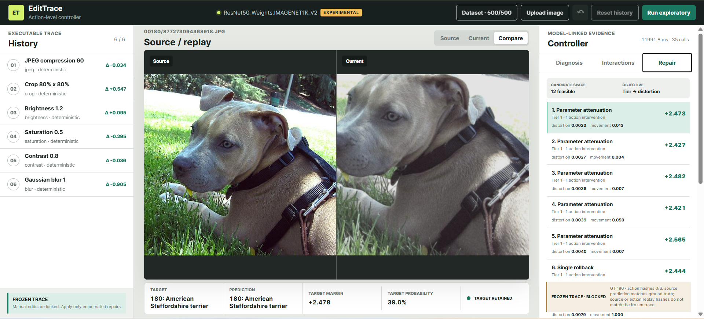

# EditTrace-XAI Controller

Interactive action-level diagnosis and constrained repair for executable image-edit histories.

EditTrace-XAI is a controlled research editor for inspecting how deterministic image-processing operations affect an image classifier. It replays edit histories, measures signed action-level counterfactual effects, identifies pairwise interactions, and proposes executable repairs through rollback or parameter attenuation.

The controller is an executable research instrument. It does not, by itself, provide evidence of usability, trust, human understanding, or improved decision-making.

## Main capabilities

- Deterministic histories of three to six distinct image edits.
- Brightness, contrast, saturation, Gaussian blur, crop-resize, and JPEG compression.
- Valid suffix replay after removing or attenuating an action.
- Target-logit margin over the strongest competing class.
- Signed leave-one-action-out diagnosis.
- Exhaustive pairwise difference-in-differences.
- Pair-only recovery detection.
- Single rollback and 20-step parameter attenuation.
- Pair rollback when no Tier 1 repair is feasible.
- Counterfactual preview, apply repair, undo, and source/current comparison.
- Optional ImageNet inference with torchvision ResNet-50 and ViT-B/16.
- Frozen-trace eligibility and replay-integrity checks.
- Diagnosis latency and model-call instrumentation.

## Evidential modes

The interface distinguishes three execution conditions.

| Mode | Target | Required checks | Intended use |
|---|---|---|---|
| Dataset, confirmatory-ready | Frozen ImageNet ground truth | Correct source prediction and exact replay integrity | Trace-level measurements to be aggregated under the frozen statistical protocol |
| Dataset, exploratory | Frozen ImageNet ground truth | One or more protocol gates failed | Debugging, failure analysis, and qualitative inspection only |
| Upload image | Prediction on the uploaded source image | No frozen ground truth or provenance | Demonstrations and qualitative case studies only |

Passing the dataset gates makes an individual execution *confirmatory-ready*. It does not turn a single interactive run into a complete experimental result. Paper results require aggregation over the frozen split, prespecified metrics, confidence intervals, and the declared statistical protocol.

## Interface

### Executable history

The left panel displays the ordered edit sequence and its parameters. Removing an action re-executes the valid suffix of the history. Manual editing is locked for frozen dataset traces; only interventions from the declared repair space can modify them.

### Image workspace

The central workspace provides three views:

- **Source**: the original image.
- **Current**: the result of the complete active history.
- **Compare**: source and current or counterfactual results side by side.

The prediction strip reports the target class, predicted class, target probability, target-logit margin, and decision state.

### Diagnosis

For action $a_i$, the controller removes the action, replays the remaining valid history, and computes

$$
\Delta_i = g(x_{-i};y) - g(x_T;y),
$$

where $g(x;y)$ is the target-logit margin. A positive value means that removing the action increases the target margin. The interface also reports the adjacent-step score decrease, normalized edit magnitude, counterfactual margin, and whether the removal restores the target.



### Interactions

For each pair $(a_i,a_j)$, the controller computes

$$
I_{ij} = g(x_{-\{i,j\}};y) - g(x_{-i};y) - g(x_{-j};y) + g(x_T;y).
$$

The interface flags pair-only recovery when neither single removal restores the target but their joint removal does.



### Repair

Tier 1 evaluates every single rollback and twenty non-zero attenuation steps toward the explicit identity of each operation. Tier 2 evaluates pair rollbacks only when Tier 1 has no feasible repair.

Feasible candidates are ordered by repair tier, image distortion, normalized parameter movement, restored margin, and deterministic candidate ID. Optimality is claimed only within this frozen candidate space and hierarchical objective.

**Preview Selected** is non-destructive. **Apply Repair** commits the selected intervention, and **Undo** restores the preceding history state.



## Requirements

- Python 3.12
- NumPy
- Pillow 12.3.0
- PyTorch and torchvision for ImageNet models

Install the base dependencies:

```bash
python -m pip install -r requirements.txt
```

Install the optional model dependencies:

```bash
python -m pip install torch torchvision
```

## Quick start

### Dependency-free workflow demo

```bash
python run.py
```

The default surrogate model verifies the editor workflow but does not produce experimental evidence.

### ResNet-50 on Windows CMD

```bat
set "EDITTRACE_MODEL=resnet50"
python run.py
```

### ResNet-50 on PowerShell

```powershell
$env:EDITTRACE_MODEL="resnet50"
python run.py
```

### ResNet-50 on Linux or macOS

```bash
EDITTRACE_MODEL=resnet50 python run.py
```

Replace `resnet50` with `vit_b_16` to use ViT-B/16. Open <http://127.0.0.1:8017> after the server starts.

The frozen torchvision identifiers are:

- `ResNet50_Weights.IMAGENET1K_V2`
- `ViT_B_16_Weights.IMAGENET1K_V1`

## Frozen dataset layout

The trace catalog is stored as `data/01-traces.jsonl`. ImageNet images are not distributed with this repository. Place locally licensed source images under `data/images/`, preserving each trace `source_id`:

```text
data/
  01-traces.jsonl
  images/
    00888/
      584755295296828.jpg
    00201/
      252218170729788.jpg
```

Alternative locations can be provided without changing the repository:

```bat
set "EDITTRACE_IMAGES=C:\absolute\path\to\images"
set "EDITTRACE_TRACES=C:\absolute\path\to\01-traces.jsonl"
set "EDITTRACE_MODEL=resnet50"
python run.py
```

The images root must directly contain the class-number directories referenced by `source_id`.

## Repository structure

```text
backend/
  core.py          Edit engine, replay, diagnosis, interactions, and repair
  dataset.py       Frozen trace catalog and integrity validation
  server.py        HTTP API and static frontend server
web/
  index.html       Controller interface
  app.js           Client state and interactions
  styles.css       Responsive layout
tests/
  test_core.py     Determinism, replay, diagnosis, repair, and dataset tests
data/
  01-traces.jsonl  Frozen trace catalog
  images/          Local ImageNet images; excluded from version control
run.py             Application entry point
```

## Verification

Run the automated checks with:

```bash
python -m unittest discover -s tests -v
node --check web/app.js
```

The current suite covers all six deterministic operations, history constraints, valid suffix replay, the declared single-action effect, pairwise difference-in-differences, executable repair, undo, and frozen-schema mapping.

## API overview

- `GET /api/health`: active model and execution mode.
- `GET /api/dataset`: catalog and image-availability status.
- `GET /api/traces`: searchable trace listing.
- `POST /api/traces/open`: open a frozen trace.
- `POST /api/sessions`: create a free-upload session.
- `POST /api/sessions/{id}/actions`: append a validated edit.
- `POST /api/sessions/{id}/diagnose`: compute diagnosis, interactions, and repair candidates.
- `POST /api/sessions/{id}/preview`: execute a non-destructive intervention.
- `POST /api/sessions/{id}/apply-repair`: commit a repair candidate.
- `POST /api/sessions/{id}/undo`: restore the preceding history.

## Reproducibility and data policy

- Do not commit or redistribute ImageNet image files unless their license explicitly permits it.
- Do not commit downloaded model weights, local caches, virtual environments, or generated evaluation outputs.
- Preserve the frozen JSONL catalog, weight identifiers, Pillow/libjpeg environment, preprocessing, seeds, and statistical protocol used for reported experiments.
- Treat a replay-hash mismatch as an invalid confirmatory execution.
- Sanitize machine-specific `source_path` values before publishing trace files. The controller resolves images through `source_id` and does not require the absolute source path.

Sanitize the bundled catalog before the first public commit:

```bash
python tools/sanitize_trace_paths.py data/01-traces.jsonl --in-place
```

The command creates an ignored `.bak` copy and preserves all fields required by the controller.

## Current limitations

- Sessions are stored in process memory and are not intended for multi-user deployment.
- The interactive controller does not replace the batch evaluation and statistical-analysis pipeline.
- The current UI reports normalized pixel RMSE as the repair-distortion value; paper results must use the perceptual metric frozen in the final protocol.
- No user study has been conducted; the system does not support human-centered claims.
- Exact JPEG hashes can depend on the Pillow and libjpeg build.

## Citation

Citation metadata will be added after the associated paper is publicly available. Until then, please cite the repository URL and the accessed commit hash.

## License

Add the selected software license before making the repository public. The software license does not grant redistribution rights for ImageNet images or third-party model weights.
